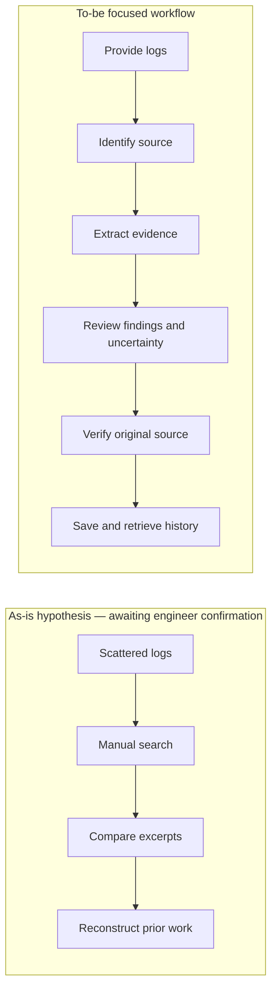

# As-is / to-be journey

The as-is journey is a **student-reported working hypothesis**, not an observed usability session. To-be is the focused design target; implementations and remaining gaps are in the traceability matrix.

| Stage | Hypothesized current friction | Target experience | Requirement |
|---|---|---|---|
| Collect logs | Scattered files and uncertain product | Choose text, one file or bounded bundle with clear limits | FR-01 |
| Identify source | Similar numeric codes across vendors | Source-qualified identity; unknown stays unknown | FR-02 |
| Investigate | Generic suggestions mistaken for evidence | Observed evidence separated from hypotheses | FR-03/05 |
| Verify | Finding separated from original context | Original filename and line reference | FR-04 |
| Review later | Repeated investigation, changing totals | Retrieve known saved analysis by identity/history | FR-06 |

