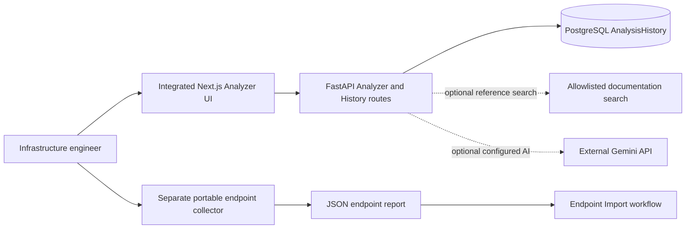
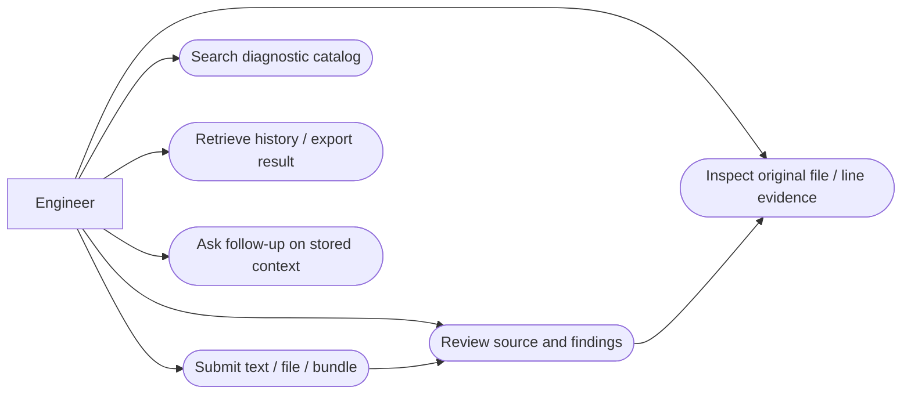
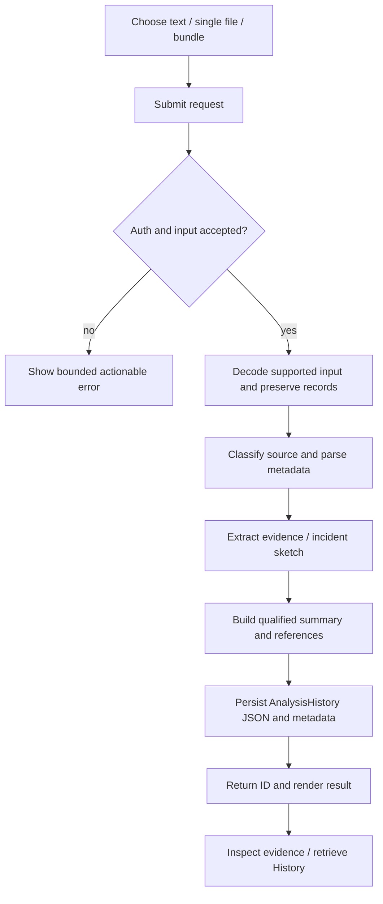
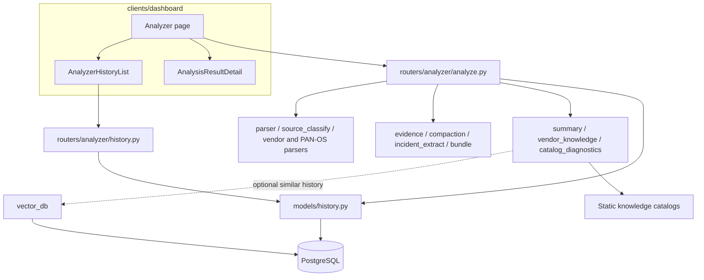
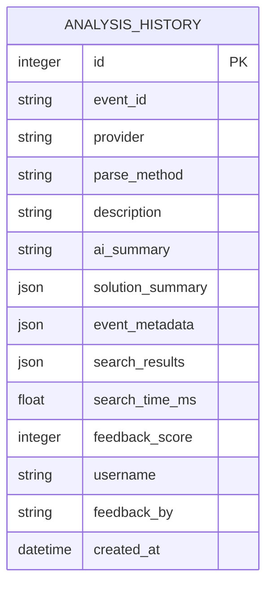

# Focused system design — editable Mermaid

Diagrams 1, 2, 4, 5, 6 and 7 are reconstructed **as-built from source**, with optional/conditional branches labeled. Diagram 3 is a provisional journey target. No live deployment or production topology was verified. Sequence abstracts both `/api/v1/analyze/` and `/api/v1/analyze/bundle`; returned fields differ. All names map to existing source rather than new services.

## 1. System context / user interaction (as-built)


## 2. Use cases (as-built flowchart notation)
The flowchart below remains a navigation view. The formal UML Use Case view is [PlantUML source](ANALYZER_USE_CASE.puml), with actor, system boundary and use cases. Its source has been reviewed; a rendered diagram has not been visually verified in this continuation.


## 3. Journey (hypothesis / proposed target)
See AS_IS_TO_BE_WORKFLOW.md for the editable as-is/to-be diagram and explicit confirmation boundary.

## 4. Analyzer activity / user flow (as-built)


## 5. Components (as-built)


## 6. Analyze request sequence (as-built, simplified)
```mermaid
sequenceDiagram
 actor Engineer
 participant UI as Analyzer UI
 participant API as Analyze route
 participant Auth as Auth dependency
 participant Parse as Parsers/evidence helpers
 participant Summary as Summary service
 participant DB as Async DB session
 Engineer->>UI: Select synthetic logs
 UI->>API: Multipart text/file or bundle
 API->>Auth: Resolve secure user or demo policy
 alt Invalid auth/input
   API-->>UI: 4xx validation error
 else Accepted
   API->>Parse: Bounded decode, classify, preserve source/line
   Parse-->>API: Metadata and evidence
   API->>Summary: Qualified summary request
   Note over Summary: Deterministic knowledge first; optional retrieval / external AI
   Summary-->>API: Evidence, hypotheses and uncertainty
   API->>DB: Add AnalysisHistory, commit and refresh
   DB-->>API: Stored ID
   API-->>UI: Result and historyId / bundleId alias
   UI-->>Engineer: Review finding and source evidence
 end
```

## 7. Focused ERD (as-built physical storage)

Evidence items, incident sketch and bundle attributes are embedded JSON, **not separate evidence tables or foreign keys**. `username` is a string; the model declares no user FK. `bundleId` is an API identity alias, not a new bundle table. Legacy rows are defensively deserialized by history helpers. Vector retrieval uses the existing model/storage; this diagram does not invent an evidence relationship. USB asset/event relations belong to the separate supporting workflow.
